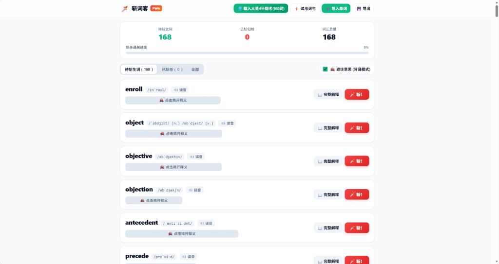

# 🗡️ 斩词客 (WordSlasher)

> **极简、爽快、无限自由的跨端背单词与刷词利器**  
> 专治商业背单词软件无法导入生词、强制收费买词书的痛点，支持自定义无限导入、百词斩式卡片流、磨砂自测遮罩、一键刀光斩词动效与真实破风砍切音效。

[](LICENSE)
[]()
[]()
[]()

---

## 🌐 在线体验与演示

* **⚡ 生产环境在线直达**：[https://pwa-ten-sand.vercel.app/](https://pwa-ten-sand.vercel.app/)
* **📱 手机端使用**：使用 iPhone Safari 或安卓手机浏览器打开上述链接，点击 **「添加到主屏幕 / 添加至桌面」**，即可秒变全屏独立原生 App，支持脱机离线使用！

---

## 📸 界面预览



---

## ✨ 核心特性亮点

### 1. 彻底打破词库封锁：无限自由导入
* **纯英文导入**：直接粘贴单词列表（每行一个），系统自动联网调用国际权威英英/中英词典补齐音标、释义与例句；
* **自定义对照导入**：支持从微信、Excel、备忘录或教材中复制中英对照文本（支持 `空格`、`Tab`、`-`、`/音标/` 等任意混合格式），一键自动智能分词并去重。

### 2. 经典百词斩式刷词流与“遮住意思”自测
* **磨砂遮罩自测**：默认开启“🙈 遮住意思 (背诵模式)”，所有释义被高斯模糊与遮盖；
* **双向自由切换 (Toggle)**：点击遮罩立即揭开释义开始自测；再次点击释义区域**立刻重新遮住**，专为强化自测记忆设计。

### 3. 极具爽感的“斩！”交互与程序化音效
* 点击红色 **「🗡️ 斩！」** 按钮，触发**高亮红色刀光划痕**与卡片飞散淡出动画；
* **Web Audio API 纯代码程序化音频**：零音频文件依赖，利用高频白噪声与带通滤波器指数衰减，合成出极其清脆逼真的刀剑破风斩击声；
* 配合手机端**线性马达轻微震动反馈**（Haptic Feedback），打造解压沉浸的刷词手感；
* 实时统计“待斩生词”、“今日已斩”、“词汇总量”与斩杀进度百分比，已斩词库随时支持“↩ 复活”。

### 4. 深度考点与完整解释抽屉
* 每张卡片均配有 **「📖 完整解释」**：移动端自适应底部抽屉，PC 端居中弹窗；
* 展示完整美音/英音国际音标、真题权威例句、词源背景记忆标签以及牛津/韦伯权威多词性全英拓展。

### 5. 电脑端全键盘盲操神器
双手不离键盘，大幅提升考前刷词速度：
* <kbd>Space</kbd>（空格键）：全局一键切换【遮住 / 揭开】全部释义；
* <kbd>Enter</kbd>（回车键）：一键斩掉当前首个生词；
* <kbd>S</kbd> 键：即刻触发首词系统级免流量真人发音（Web Speech API）。

---

## 📚 内置词库

本项目已默认预装并持久化内置：
* **《大学英语4》半期考核心高频考点词库（全量 168 词）**
  * 深度聚合大纲必背词、真题考点、课后习题长句汉译英采分词及近义易混辨析；
  * 打开即满血就绪，待斩词汇 168 个，支持一键重置与本地备份。

---

## 📥 自定义导入格式示例

在右上角点击 **「➕ 导入单词」**，支持以下任意格式自由混合粘贴：

```text
# 格式一：纯英文单词（自动联网检索释义）
serendipity
ubiquitous
ephemeral

# 格式二：单词 - 中文释义
altruism - 利他主义，无私品德
pragmatic - 讲求实际的，重实效的

# 格式三：带音标格式
resilience [rɪˈzɪl.jəns] 适应力；坚韧
procrastinate /proʊˈkræs.tə.neɪt/ 拖延，耽搁
```

---

## 📱 移动端安装指南 (PWA)

### 苹果 iOS (iPhone / iPad)
1. 在微信中复制链接，或直接用 **Safari 浏览器** 打开：[https://pwa-ten-sand.vercel.app/](https://pwa-ten-sand.vercel.app/)；
2. 点击 Safari 底部中央的 **「分享」图标**（带有向上箭头的方框）；
3. 往下滑动并选择 **「添加到主屏幕」**；
4. 点击右上角“添加”，桌面上即出现专属图标，全屏无地址栏沉浸运行。

### 安卓 (Android)
1. 使用 **Chrome**、**Edge** 或系统自带浏览器打开链接；
2. 点击右上角菜单按钮（三点图标）选择 **「添加至主屏幕」** 或 **「安装应用」** 即可。

---

## 🛠️ 技术架构与设计哲学

* **单文件自包含（Single-file Architecture）**：全套 UI、CSS 动画、Web Audio 音效合成器、本地数据解析引擎全部内嵌于单个 `index.html`，零依赖、零编译负担；
* **本地沙盒数据隔离（Privacy & LocalStorage）**：数据保存在浏览器本地，无需注册登录，无第三方埋点追踪，绝无隐私泄露；
* **无障碍与沙盒兼容**：彻底规避移动端系统弹窗拦截机制，采用原生浮动黑金 Toast 提示与内存容灾，在任意受限环境均可顺畅运行。

---

## 📄 开源许可证

本项目基于 [MIT License](LICENSE) 开源，允许自由使用、修改与分发。
